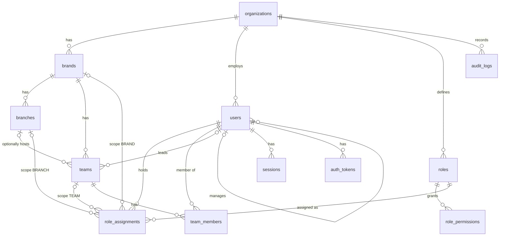

# Entity relationship diagram

Current as of Phase 2 (migration `20261127052420_identity`). Every table except `organizations` carries
`organization_id` and is protected by row-level security. Children reference parents with composite keys
`(organization_id, id)`, so a row can never point at another organization's record.

| Table                       | Notes                                                                                                                                                                                                           |
| --------------------------- | --------------------------------------------------------------------------------------------------------------------------------------------------------------------------------------------------------------- |
| `organizations`             | Tenant. `country` IN/AE, default `timezone` and `currency`. Status ACTIVE/SUSPENDED.                                                                                                                            |
| `brands`                    | Own country, time zone, currency. Code unique per organization. Archived, never deleted.                                                                                                                        |
| `branches`                  | Belong to a brand; time zone defaults from brand.                                                                                                                                                               |
| `users`                     | `organization_id` null only for platform admins (CHECK). Email lower-case, globally unique. Status INVITED → ACTIVE → SUSPENDED/DEACTIVATED. `max_active_leads`, `languages` reserved for allocation (Phase 6). |
| `roles`, `role_permissions` | 10 system roles per organization from `packages/contracts`; custom roles allowed. Permission keys validated against the catalog.                                                                                |
| `role_assignments`          | Scope ORGANIZATION / BRAND / BRANCH / TEAM (CHECK keeps columns consistent). Revoked, never deleted (`revoked_at`, `revoked_by_id`, `revoke_reason`).                                                           |
| `team_members`              | Leaving sets `left_at`; one active membership per user per team (partial unique index).                                                                                                                         |
| `sessions`                  | Refresh-token rotation families; hashed tokens only.                                                                                                                                                            |
| `auth_tokens`               | Invite (7 days) / password reset (30 minutes); hashed, single-use.                                                                                                                                              |
| `audit_logs`                | Append-only: UPDATE/DELETE/TRUNCATE blocked by trigger, and privileges revoked from `crm_app`.                                                                                                                  |
