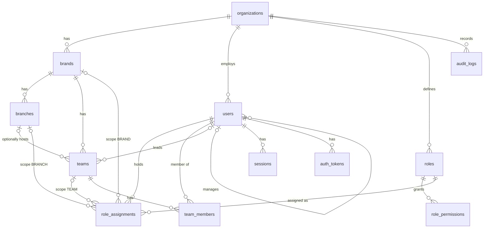
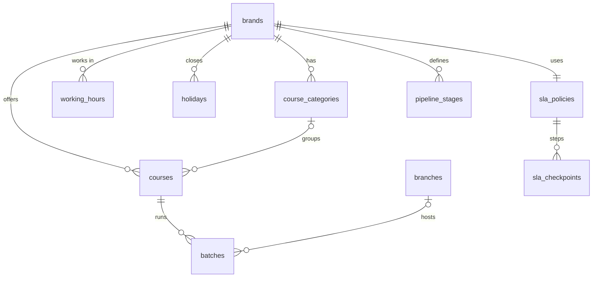
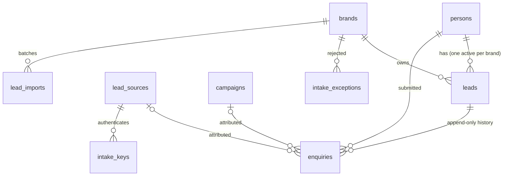

# Entity relationship diagram

Current as of Phase 5 (migrations `…_identity`, `…_catalog_and_settings`, `…_lead_capture`, `…_duplicates_and_timeline`). Every table except `organizations` carries
`organization_id` and is protected by row-level security. Children reference parents with composite keys
`(organization_id, id)`, so a row can never point at another organization's record.

| Table                       | Notes                                                                                                                                                                                                           |
| --------------------------- | --------------------------------------------------------------------------------------------------------------------------------------------------------------------------------------------------------------- |
| `organizations`             | Tenant. `country` IN/AE, default `timezone` and `currency`. Status ACTIVE/SUSPENDED.                                                                                                                            |
| `brands`                    | Own country, time zone, currency. Code unique per organization. Archived, never deleted.                                                                                                                        |
| `branches`                  | Belong to a brand; time zone defaults from brand.                                                                                                                                                               |
| `users`                     | `organization_id` null only for platform admins (CHECK). Email lower-case, globally unique. Status INVITED → ACTIVE → SUSPENDED/DEACTIVATED. `max_active_leads`, `languages` reserved for allocation (Phase 6). |
| `roles`, `role_permissions` | 10 system roles per organization from `packages/contracts`; custom roles allowed. Permission keys validated against the catalog.                                                                                |
| `role_assignments`          | Scope ORGANIZATION / BRAND / BRANCH / TEAM (CHECK keeps columns consistent). Revoked, never deleted (`revoked_at`, `revoked_by_id`, `revoke_reason`).                                                           |
| `team_members`              | Leaving sets `left_at`; one active membership per user per team (partial unique index).                                                                                                                         |
| `sessions`                  | Refresh-token rotation families; hashed tokens only.                                                                                                                                                            |
| `auth_tokens`               | Invite (7 days) / password reset (30 minutes); hashed, single-use.                                                                                                                                              |
| `audit_logs`                | Append-only: UPDATE/DELETE/TRUNCATE blocked by trigger, and privileges revoked from `crm_app`.                                                                                                                  |

## Phase 3 tables

| Table                             | Notes                                                                                                                                              |
| --------------------------------- | -------------------------------------------------------------------------------------------------------------------------------------------------- |
| `course_categories`, `courses`    | Per brand; code unique per brand; `list_fee_minor` BIGINT minor units + `currency` (= brand currency); duration value/unit both or neither (CHECK) |
| `batches`                         | Per course; optional branch (same brand); `start_date`/`end_date` DATE (end ≥ start CHECK); `capacity ≥ 0`                                         |
| `working_hours`                   | ISO weekday 1–7, minutes from local midnight, start < end (CHECK); multiple shifts per day                                                         |
| `holidays`                        | Local date per brand, unique                                                                                                                       |
| `sla_policies`, `sla_checkpoints` | One policy per brand; ordered checkpoints with action and WORKING/CALENDAR basis                                                                   |
| `pipeline_stages`                 | 8 fixed keys per brand; editable label and required fields                                                                                         |

## Phase 4 tables

| Table                       | Notes                                                                                                                                                                          |
| --------------------------- | ------------------------------------------------------------------------------------------------------------------------------------------------------------------------------ |
| `persons`                   | Unique `(organization_id, phone_e164)`; email lower-case; phone or email required (CHECK); `do_not_contact` for opt-outs                                                       |
| `leads`                     | `lead_number` unique per org (L-000001 via `org_counters`); status enum; stage = pipeline key; partial unique: one active (OPEN/ON_HOLD/IN_RECOVERY) lead per person per brand |
| `enquiries`                 | **Append-only** (trigger + only SELECT/INSERT granted): channel, source, campaign, UTM, ad/form IDs, raw submitted values, consent; unique `(brand_id, dedup_key)`             |
| `lead_sources`, `campaigns` | Per brand; 9 default sources created per brand                                                                                                                                 |
| `intake_keys`               | SHA-256 hash only; revocable; `last_used_at`                                                                                                                                   |
| `intake_exceptions`         | Rejected submissions with payload + errors; OPEN → RESOLVED / DISCARDED                                                                                                        |
| `lead_imports`              | Per upload: counters, duplicate policy, status                                                                                                                                 |
| `outbox_events`             | `lead.created` / `enquiry.received`, written in the same transaction                                                                                                           |

## Phase 5 additions

| Table / column                                    | Notes                                                                                                      |
| ------------------------------------------------- | ---------------------------------------------------------------------------------------------------------- |
| `persons.name_key`, `merged_into_id`, `merged_at` | Phone uniqueness now applies to unmerged people only; merged rows keep their contacts for matching         |
| `leads.merged_into_lead_id`, status `MERGED`      | Merged leads keep their number and enquiries                                                               |
| enquiry classification                            | + `EXISTING_PERSON`, `CROSS_CHANNEL_DUPLICATE`                                                             |
| `duplicate_candidates`                            | Pair (a < b), score, reasons, OPEN/MERGED/DISMISSED; unique pair                                           |
| `person_merges`                                   | **Append-only**: field choices, lead plan, before-snapshots, who/when/note                                 |
| `lead_events`                                     | **Append-only** timeline events (NOTE, PROFILE_UPDATED, LEAD_MERGED, PERSON_MERGED; calls etc. in Phase 8) |

## Phase 6 additions

| Table / column                                  | Notes                                                                                                           |
| ----------------------------------------------- | --------------------------------------------------------------------------------------------------------------- |
| `users.is_available`, `availability_changed_at` | Personal "taking leads" toggle                                                                                  |
| `user_leaves`                                   | Leave date ranges (brand time zone); cancelled, never deleted                                                   |
| `allocation_settings`                           | Per brand: enabled, respect working hours, default strategy, rule version                                       |
| `allocation_rules`                              | Ordered per brand; conditions (courses, channels, languages, cities) → pool (team or users) + strategy          |
| `allocation_runs`                               | **Append-only**: every attempt with outcome, candidates, exclusion reasons, rule and rule version               |
| `lead_assignments`                              | **Append-only** ownership history: from/to, type (AUTO, MANUAL, REASSIGN_AUTO, RECOVERY), reason, over capacity |
| `notifications`                                 | In-app notifications, unique `(user_id, dedup_key)`                                                             |

## Phase 7 additions

| Table           | Notes                                                                                                                             |
| --------------- | --------------------------------------------------------------------------------------------------------------------------------- |
| `tasks`         | Owner, type, priority, due, status OPEN/COMPLETED/CANCELLED (overdue = open past due), outcome, notes; one `is_initial` per lead  |
| `sla_instances` | First-response clock per lead: policy snapshot, state, fired checkpoints, generation, consumed minutes, both clocks on resolution |
| `sla_events`    | **Append-only**: started, checkpoint, reminder/alert sent, reassigned/failed, breached, escalated, paused/resumed, resolved       |
| `jobs`          | Background job queue: unique key, status PENDING/RUNNING/DONE/DEAD/CANCELLED, attempts, last error                                |

## Phase 8 additions

| Table               | Notes                                                                                                                                          |
| ------------------- | ---------------------------------------------------------------------------------------------------------------------------------------------- |
| `activities`        | **Append-only** interaction history: call / WhatsApp / email / SMS, direction, actor, times, outcome, content, provider reference, linked task |
| `outbound_messages` | Delivery state of an outbound message: QUEUED → SENT → DELIVERED → READ, or FAILED; attempts, last error; unique (provider, provider_ref)      |
| `message_events`    | **Append-only**: queued, sent, retry, failed, every provider receipt (applied or ignored)                                                      |
| `message_templates` | Per brand and channel; DRAFT / APPROVED / ARCHIVED; provider template name                                                                     |
| `appointments`      | Counselling: counsellor, start/end, mode, place or link, SCHEDULED / COMPLETED / NO_SHOW / CANCELLED, summary                                  |

## Phase 9 additions

| Table / column           | Notes                                                                                                                                                                      |
| ------------------------ | -------------------------------------------------------------------------------------------------------------------------------------------------------------------------- |
| `leads.stage_changed_at` | When the current stage was entered                                                                                                                                         |
| `lead_stage_history`     | **Append-only**: from, to, FORWARD/BACKWARD, actor, reason, snapshot of which stage fields were present                                                                    |
| `lead_qualifications`    | One per lead: qualification, eligibility, requirement, interest, preferred courses, intake, fee readiness, objections                                                      |
| `quotations`             | Q-number per organization, course, batch, list fee − discount = total (minor units, CHECK), validity, OPEN/ACCEPTED/REJECTED/SUPERSEDED/EXPIRED; terms immutable (trigger) |
| `saved_views`            | Per-user named filters for the leads list and pipeline board                                                                                                               |

## Phase 10 additions

| Table                 | Notes                                                                                                                                                   |
| --------------------- | ------------------------------------------------------------------------------------------------------------------------------------------------------- |
| `loss_reasons`        | Per brand: code, label, recoverable, active, order (defaults back-filled)                                                                               |
| `recovery_policies`   | Per brand: enabled, cooldown, max attempts, interval, owner mode, auto-close                                                                            |
| `lead_status_history` | **Append-only**: every status change (lost, recovery, reopen, close, hold/resume) with reason and actor                                                 |
| `recovery_cases`      | SCHEDULED → ACTIVE → RECOVERED / CLOSED / CANCELLED; loss reason and notes; owner follows the lead owner; one live case per lead (partial unique index) |
| `recovery_attempts`   | **Append-only**: attempt number, channel, result, notes, alternative course offered, next date                                                          |

## Phase 11 additions

| Table                          | Notes                                                                                                                                             |
| ------------------------------ | ------------------------------------------------------------------------------------------------------------------------------------------------- |
| `students`                     | One per person: legal name, date of birth, guardian, address, nationality, ID type/number (PII)                                                   |
| `admission_settings`           | Per brand: admission number format, confirm-only-after-approval                                                                                   |
| `document_types`               | Per brand checklist items (code, label, required by default, accepted file types)                                                                 |
| `course_document_requirements` | Per course override of required / optional                                                                                                        |
| `admissions`                   | Lead, student, course, batch, quotation, status, admission number (unique per org), seat held / override with reason; one live admission per lead |
| `admission_status_history`     | **Append-only** status changes with reason and actor                                                                                              |
| `admission_documents`          | Checklist item per admission: MISSING / UPLOADED / VERIFIED / REJECTED (reason), current file                                                     |
| `document_files`               | **Append-only** file versions: name, type, size, SHA-256, storage key                                                                             |
| `document_blobs`               | **Append-only** file contents (default storage)                                                                                                   |
| `document_reviews`             | **Append-only** verify / reject decisions                                                                                                         |
| `lms_handovers`                | One per confirmed admission: payload snapshot, status, provider reference                                                                         |

## Phase 12 additions

| Table / column             | Notes                                                                                                         |
| -------------------------- | ------------------------------------------------------------------------------------------------------------- |
| admission status           | + `CANCELLED_REFUNDED` (A-007b)                                                                               |
| `finance_settings`         | Per brand: receipt number format, minimum confirming amount, default due days, refund maker–checker           |
| `fee_plans`                | One per admission: currency, base amount (minor units)                                                        |
| `fee_adjustments`          | **Append-only** signed adjustments with reason                                                                |
| `instalments`              | Schedule (seq, due date, amount); paid/due computed oldest-first                                              |
| `payment_attempts`         | Gateway orders: PENDING → SUCCEEDED / FAILED / DISPUTED / EXPIRED, mismatch flag; unique (provider, order id) |
| `payment_events`           | **Append-only** webhooks as received; unique (provider, event id); invalid signatures stored under random ids |
| `payments`                 | **Append-only** verified money: amount, method, reference, receipt number (unique), verification source       |
| `refunds`, `refund_events` | **Append-only** request + APPROVED / REJECTED / PAID decisions                                                |

## Phase 13 additions

| Table             | Notes                                                                                                                             |
| ----------------- | --------------------------------------------------------------------------------------------------------------------------------- |
| `targets`         | Scope ORGANIZATION / BRAND / TEAM / USER, optional course, metric, period, value (count or minor units + currency); audited       |
| `ad_spend`        | Manual spend per campaign and month (unique), brand currency                                                                      |
| `incentive_rules` | **Append-only** versioned rules (unique brand + name + version): basis, amount or basis points, threshold, cap, exclusions, split |
| `incentive_runs`  | Per brand, rule version and period: DRAFT → APPROVED (approver ≠ creator); a trigger refuses any change once approved             |
| `incentive_lines` | **Append-only** EARNED / CLAWBACK lines per person with their inputs (admission / payment ids, rule version)                      |

## Phase 14 additions

| Table / column                                           | Notes                                                                                                                      |
| -------------------------------------------------------- | -------------------------------------------------------------------------------------------------------------------------- |
| `leads.priority_band`, `priority_rank`, `priority_score` | Effective AI priority for sorting (latest override, else latest score); derived, recomputed                                |
| `ai_settings`                                            | One per brand: enabled (default off), scoring / next actions, thresholds (bp), minimum training size                       |
| `ai_models`                                              | **Append-only** model versions: sample size, conversions, usable, factor counts                                            |
| `lead_scores`                                            | **Append-only** score history (a row only on change): method, model version, score, band, probability, confidence, factors |
| `lead_score_overrides`                                   | **Append-only** human overrides with reason                                                                                |
| `ai_suggestion_events`                                   | **Append-only** accepted / dismissed next-best actions                                                                     |

## Lead source additions (A-047, A-048)

| Table / value               | Notes                                                                                                                                                |
| --------------------------- | ---------------------------------------------------------------------------------------------------------------------------------------------------- |
| `meta_connections`          | Facebook page per brand: source, page id (unique), page name, `token_sealed` (AES-256-GCM), status ACTIVE/PAUSED, subscribed, last lead / error; RLS |
| `LeadChannel.GOOGLE_SHEETS` | New channel; every brand gets a "Google Sheets" source                                                                                               |
